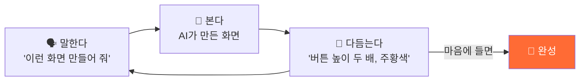
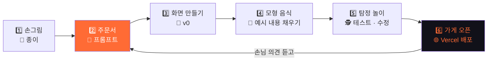
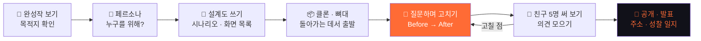
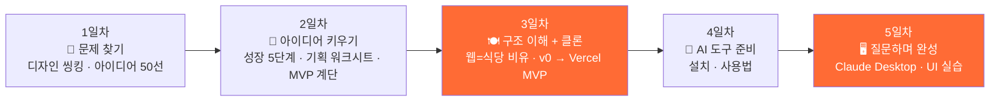

# 김종필 · AI Maker Lab(만랩) 대표

> **피지컬 컴퓨팅 AI × 바이브 코딩으로, 학생이 "실제로 출시되는" 웹·앱·하드웨어를 만들게 합니다.**
> 개발 경력 14년 + 코딩·AI 교육 경력 11년. 교육 플랫폼 4개, 상용 서비스 1개, 학생용 서비스 4개를 혼자 AI와 함께 기획·개발·운영하고 있습니다.

| 항목 | 내용 |
|---|---|
| 소속 | AI Maker Lab(만랩) 대표 · 프로젝트 개발 연구자 |
| 연락처 | 010-2708-0051 · jp798@naver.com · support.aimakerlab@gmail.com |
| 대표 사이트 | [aimakerlab.com/why-project](https://aimakerlab.com/why-project) |
| 사업자 | 만랩 · 사업자등록번호 760-57-00294 · 통신판매업 2025-하남시-0894 |
| 학력 | 수원대학교 컴퓨터과학과 졸업 (1998–2005) |

---

## 1. 현재 운영 방향

> **"우리는 개발자를 키우지 않습니다. 아이디어를 실행하는 실행자를 키웁니다."** — AI Maker Lab

두 개의 축으로 교육과 사업을 운영합니다. 수업은 **체험반(완성된 서비스를 써 보고 많이 경험하기) → 심화반(나만의 프로젝트 출시)** 순서로 진행합니다.

### ① 피지컬 컴퓨팅 AI
- 아두이노·라즈베리파이 + 센서/카메라 + AI(컴퓨터 비전, 음성, LLM)를 결합한 **"움직이고 반응하는" 제품** 만들기
- AI가 짜 준 코드를 실물로 옮기는 수업 — 예: `Arduino Uno + 조도 센서(A0) + LED(9번 핀)`, **아두이노 CO₂ 측정기 → 환기 알림 서비스**
- 하드웨어 결과물 산출물: 동작 시나리오 · 부품 목록 · 제작 순서 · 실험·개선 기록
- 2014년부터 이어온 메이커·IoT·자율주행·스마트팜·챗봇 교육 경험을 AI 시대에 맞게 재구성

### ② 바이브 코딩 기반 상용 웹·앱 제작
- **"문법을 외우는 코딩에서, 말로 만드는 실제 서비스로"** — 프론트(화면)를 먼저 검증하고 백엔드(Django)를 연결하는 순서
- 수업 기준 MVP 제작 시간 **7시간 → 35분** (UI·백엔드·배포 포함)
- 서비스 수준까지 AI에게 **100회 이상 묻고, 검증하고, 책임지는** 훈련 — 학생은 기획자·실행자·디버거·성찰자 4역할을 순환
- 1년간 10개 서비스를 직접 만들며 얻은 결론: **개발의 80%는 기획과 프론트 페이지**
- 도구: Google AI Studio, v0, Bolt, Lovable, Cursor, Claude Code → Next.js · Django/DRF · PostgreSQL · React Native(Expo) → Vercel · Railway 배포

### ③ AI 오케스트라 (상용화·자동화 과정)
- **"지휘자는 사람, 연주자는 AI"** — 정하기 → 그리기 → 만들기 → 고치기 → 출시 → 알리기 → 개선의 7단계에 **AI 도구 15개**를 배치
- 한 번 완주한 과정을 레시피·에이전트로 만들어 반복 (L0 수동 → L1 레시피 → L2 에이전트 → L3 자동화, Claude Code 스킬·n8n 활용)
- 대표 본인이 이 방식으로 **1인 3개 서비스 동시 운영** 중

### 과정 구성

| 과정 | 대상 | 시간 | 내용 |
|---|---|---|---|
| AI 동화책 (기초) | 중1~2 | 3시간 | ChatGPT 스토리 + 이미지 생성 AI 삽화 → 웹 동화책 |
| 화상 영어 AI 튜터 (중급) | 중3~고1 | 6시간 | 듀오링고·스픽 벤치마킹 AI 회화 튜터 웹앱 |
| 감정 방탈출 게임 (심화) | 고2~3 | 12시간 | 표정 인식 AI를 넣은 웹 게임 |
| 심화 프로젝트 | 중1~고3 | 16시간 | 개인 주제 프로젝트 |
| 학생 프로젝트 정규 과정 | 중·고 | 14주 · 6단계 | 문제 정의 → 기획·설계 → AI 프롬프팅 → 프로토타입 → 테스트(사용자 5명) → 배포·발표 |
| 자기주도 상용화 과정 | 중·고 | 방학 2개월 집중 + 연중 멘토링 | 4~6명 소규모, 1:4 밀착 코칭, 아이디어부터 홍보 영상·자동화까지 |

### 7단계 프로젝트 프로세스와 산출물

| 단계 | 문제 발견 | 리서치 | 기획·설계 | 프로토타입 | 테스트·개선 | 서비스 출시 | 보고서·발표 |
|---|---|---|---|---|---|---|---|
| 산출물 | 문제 정의서 | 선행 연구 정리 | 기획서·설계도 | 작동하는 시제품 | 실험·개선 기록 | 배포된 서비스 | 소논문·발표 |

**하나의 질문 → 5대 결과물**: 논문 · 리서치 · 캠페인(AI 영상) · 서비스(웹·앱) · 제품(하드웨어)
→ 고교학점제(2025 전면 시행)·2028 대입 개편에 맞춰 탐구 과정이 세특·학종 면접·논서술형 평가의 재료가 되도록 설계

---

## 2. 교육 스펙 — 바이브 코딩 수업 설계 · 운영

> **"완성품을 먼저 보고, 거꾸로 만들며 배운다."** — 역공부(Reverse Learning) + 메이커 방식
> 이론 강의 대신 **완성작 → 설계도(.md) → 클론 → 질문하며 고치기 → 배포** 순서로, 학생이 수업 안에서 **실제로 작동하는 주소(URL)**를 갖고 나가도록 설계합니다.

### 2-1. 교육 스펙 한눈에 보기

| 항목 | 내용 |
|---|---|
| 대표 과정 | [바이브 AI 코딩](https://aimakerlab.com/curriculum/vive-coding) (V0 + Cursor + ChatGPT API / Claude) |
| 대상 · 규모 | 초5 ~ 고3 · 교사 연수 · 학부모 설명회 / **반당 최대 12명**, 3인 1팀 |
| 수업 방식 | 메이커 교육(프로젝트 기반) · 이론 최소화 · 실패하고 고치며 배우기 |
| 운영 단위 | **3시간(1단계 기초) · 6시간(1단계 심화) · 16시간(2단계 자동화)** · 90분 블록 5일 과정 |
| 프로젝트 | 동화책 만들기(기초) · 화상 영어 AI 튜터(중간) · 감정 방탈출 게임(심화) · 강사 제작 앱 클론(틴스파크AI · TeenDramaro · DeepQ) |
| 사용 도구 | ChatGPT · DALL-E · Google AI Studio · **v0** · **Cursor** · **Claude** · **Vercel**(공개 주소) |
| 학생 산출물 | 페르소나·문제 정의서 · 주문서(프롬프트) · 배포 URL · Before/After 캡처 · 요청 기록 · 디버거 성찰 일지 |
| 강사 자료 | 슬라이드(Gamma 프롬프트 · 대상별 2버전) · 실습 안내서 · 설계도(.md) · 활동확인서 · PDF 가이드 9종 · 코드 템플릿 2종 |

### 2-2. 바이브 코딩 프로세스 — 3개의 고리

**① 가장 작은 고리 — 말한다 → 본다 → 다듬는다** (모든 차시에 반복)

> 🎼 **사람은 지휘자, AI는 연주자** — 무엇을·왜·누구를 위해 만들지는 학생이 정하고, 코드는 AI가 씁니다.

**② 중간 고리 — 코딩 없이 만드는 6계단** (초등·중등 실습 기준)

**③ 큰 고리 — 한 프로젝트가 완성되기까지** (모든 과정 공통)

> 💡 학생은 코드를 외우지 않습니다. 대신 **무엇을, 누구를 위해, 어떻게 바꿀지** 정확히 말하는 연습을 수십 번 반복합니다.

### 2-3. 2단계 커리큘럼 — "장인(수동 제작) → 공장(자동 생성)"

| 단계 | 순서 | 시간 | 하는 일 |
|---|---|---|---|
| **1단계 · 문제 찾고 만들기** (중학생 · 3~6시간) | ① 벤치마킹 | 30분 | 좋은 사례 3~5개를 작가·독자·교육자 관점으로 분석 |
| | ② 페르소나 | 30분 | 누구를 위한 것인가, 표면적 vs 본질적 문제 구분 |
| | ③ 기획 | 1시간 | 우리가 해결할 **진짜 문제** 정의 |
| | ④ 만들기 | 3~6시간 | ChatGPT를 **주니어 개발자(3~4년차)**로 두고 열린 프롬프트로 협업 |
| | ⑤ 돌아보기 | 1시간 | 진짜 문제를 해결했나? 무엇을 개선할까? |
| **2단계 · 자동으로 만들기** (고등학생 · 16시간) | ① 흐름 설계 | 2시간 | 손으로 하던 과정을 흐름도로 그리기 |
| | ② 화면 만들기 | 3시간 | AI로 빠르게 화면 만들고 친구에게 테스트 |
| | ③ 자동화 만들기 | 6시간 | 버튼 한 번에 콘텐츠가 만들어지도록 AI와 연결 |
| | ④ 합치고 공개 | 3시간 | 하나의 서비스로 묶어 주소로 공개 |
| | ⑤ 돌아보기 | 2시간 | 손으로 한 것 vs 자동화 비교 |

**학생이 기르는 5가지 역량** — 🔄 역공부(사례 분석·패턴 응용) · 🛠️ 메이커 & AI 협업 · 🎯 진짜 문제 찾기 · 🔍 디버거(성찰 일지) · ⚙️ 자동화 설계자(흐름 설계·반복 작업 자동화)

### 2-4. 대표 운영 사례 — 다가치학교 강남서초 「AI 발명품」 5일 과정 (2026)

길잡이교사로 **「엔트리 블록코딩으로 만드는 AI 발명품 — 문제 정의부터 피지컬 컴퓨팅까지」**를 90분 블록으로 설계·운영했습니다. 매 회차 슬라이드·실습 안내서·활동확인서를 직접 제작합니다.

| 일차 | 주제 | 수업 장치 | 학생 산출물 |
|---|---|---|---|
| 1일차 | 문제를 찾는 사람이 AI를 지휘한다 | 디자인 씽킹 워크숍 · 앱·웹 아이디어 50선 | 문제 정의 |
| 2일차 | 아이디어는 어떻게 커지는가 | 아이디어 성장 5단계 · 나만의 앱 기획 워크시트 · **LingoPang MVP 계단** 사례 | 기획 워크시트 · 손그림 3장 |
| 3일차 | 바이브 코딩: 말로 지휘해서 화면을 만든다 | "웹사이트는 식당이다" 비유 · 좋은 주문서 4약속 · 강사 제작 앱 3종 **클론 코딩 90분** | 주문서 1장 · **공개 주소** |
| 4일차 | AI 코딩 도구 준비 | Claude Desktop 등 도구 설치 · 안전하게 쓰는 법 | 내 노트북 작업 환경 |
| 5일차 | 틴스파크AI UI 직접 만들기 | 완성작 → 유저 시나리오 .md → 클론 → **Claude에게 질문하며** UI 완성 | Before/After 캡처 · 요청문 3개 |

### 2-5. 수업 설계의 차별점

| 장치 | 내용 | 효과 |
|---|---|---|
| 🎯 **완성작 먼저** | 강사가 실제 배포한 서비스(틴스파크AI · TeenDramaro · DeepQ · LingoPang)를 먼저 써 보게 함 | "목적지를 알아야 길을 물어볼 수 있다" |
| 📄 **설계도(.md) 먼저** | 유저 시나리오(페르소나·시나리오) + 페이지 설계서(사이트 맵·화면별 프롬프트) | AI에게 줄 설명서 = 발표 대본 |
| 📦 **클론 후 고치기** | 이미 돌아가는 뼈대를 받아 "여기 이 부분을 이렇게"로 고치며 출발 | 90분 안에 **내 버전** 완성 |
| 🧭 **여섯 축 요청법** | ❓왜 · 📍맥락 · 🧱제약 · 📏기준 · ⚖검증 · ✂️버릴 것을 프롬프트에 붙임 | "예쁘게"(O5) → 조건 있는 질문(O3) |
| 🪜 **요청 4단계** | 읽혀 주기 → 계획 먼저 → 한 부분만 → 보고 고치기 | 설명할 수 있는 코드만 남김 |
| 👁 **UI 다섯 눈 · 단어장** | 위계 · 대비 · 간격 · 일관성 · 피드백 / 막연한 말 → 정확한 말(Tailwind) | 문제에 이름을 붙여 정확히 요청 |
| 🛡 **안전한 AI 사용 규칙** | CLAUDE.md 반 규칙 · 권한 모드 Ask(승인 전 읽기) · 개인정보·비밀번호 금지 · 강사 계정 로그아웃 | 학교 현장에 바로 쓸 수 있는 운영 |
| 🍽️ **대상별 2버전 자료** | 초5용(식당·지휘자 비유) / 강사 연수·심화반용(완성작 구조 분석) | 같은 내용을 수준별로 전달 |
| 📊 **증거 남기는 평가** | Before/After · 요청 기록표 · 상태 5종·모바일 폭 점검표 · 디버거 성찰 일지 · 활동확인서 | 세특·포트폴리오 재료 |

### 2-6. 수업 자료 패키지 ([aimakerlab.com](https://aimakerlab.com/curriculum/vive-coding) 공개)

| 분류 | 자료 |
|---|---|
| 역공부 방법론 | 역공부 완벽 가이드(28p) · 벤치마킹 템플릿(12p) · 디버거 성찰 일지(15p) |
| 메이커 실전 | Cursor 가이드(32p) · V0 프로토타이핑 가이드(24p) · AI 자동화 가이드(38p) |
| 프로젝트별 | 동화책 제작 가이드(42p) · AI 영어 튜터 구축 가이드(45p) · 감정 게임 개발 가이드(48p, 20턴 설계) |
| 시작 템플릿 | AI Agent 템플릿 · 20턴 텍스트 게임 엔진 |

---

## 3. 경력 요약

| 기간 | 소속 · 직위 | 역할 |
|---|---|---|
| 2019 – 현재 | **AI Maker Lab(만랩)** 대표 | 프로젝트 교육 브랜드 운영, 교육 플랫폼·서비스 기획·개발 |
| 2020.07 – 2024.12 | **㈜컬리지니에이아이** 연구소 선임연구원 매니저 | AI(GPT) 기반 에세이 컨설팅 서비스 프론트엔드 개발 리드 |
| 2014.04 – 2020.05 | **㈜씨에이씨(CAC)** 연구소장(기술이사) · *현재 폐업* | 코딩·메이커·AI 교육 프로그램 제작, 강의 및 교사 연수 |
| 2011 – 2014 | DAMMANN FRERES KOREA | 개발 자문 |
| 2010 – 2011 | 파노라마코리아 | 개발 |
| 2005.08 – 2009.04 | **에이스택㈜** 연구소 주임연구원 · *현재 폐업* | 군수항공 통신장비 디바이스 드라이버·테스트 프로그램 개발 |

---

## 4. 수업 · 교육 이력

> 누적 **약 3,000명 이상**의 초·중·고·대학생과 교사 대상 **100회 이상** 교육·연수 (인천·강화 지역 3년간 5,000명 이상 포함)

### 4-1. 대학교

| 기간 | 기관 | 내용 |
|---|---|---|
| 2021 – 2024 (매년) | 가천대학교 기계공학과 | 컴퓨터 비전 기반 **AI 자율주행차** 교육 |
| 2017 – 2020 | 전북대학교 | 전문 코딩 수업, 컨설팅위원 위촉 |
| 2016 – 2017 | 한양대학교 | 스마트창작터 메이커 기술창업 교육 캠프 |
| 2017 – 2020 | 한양대·단국대 | 창업·취업 역량 강화 메이커 코딩 강의, SW 전문가 과정 |
| 2017 | 단국대학교 | DKU 가치확산 대학생 SW 교사 양성 |
| 2018 | 선문대학교 | 음성 인식 자동차 제어 교육 |
| 2019 – | 가천대·전북대·원광대 등 | 컴퓨터 비전 + Google Dialogflow 챗봇 AI 교육 |
| 2017 – | 대학 취업역량 과정 | 전문 코딩 교육 10회 |

### 4-2. 초·중·고 및 교육청

| 기간 | 기관 | 내용 |
|---|---|---|
| 2014 – 2017 | 인천·강화 지역 학교 | 연간 1,000명 이상, 누적 5,000명 이상 SW 교육 |
| 2017 | 인천·강화 130개 학교 | 미래체험 교육 프로그램 개발·운영 |
| 2014 – 2017 | 인천·강화 | 교사 연수 20회 |
| 2015 – 2016 | 동신중학교 | 소프트웨어 선도학교 SW 교육 |
| 2018 | 세종시교육청 | 교사 코딩 연수 4회, 스마트팜 교육 (약 100명) |
| 2014 – | 서울·인천·세종 | 전문강사 및 교사 연수 |

### 4-3. 공공기관 · 지역 기관

| 기간 | 기관 | 내용 |
|---|---|---|
| 2014 | 창업진흥원 | 창업인턴제 프로그램 |
| 2016 | 충북창조경제혁신센터 | 디자인 해커톤 진행 |
| 2016 – 2018 | 전남창조경제혁신센터 | 6차산업 창업캠프 |
| 2019 | 온기랩 메이커스페이스 | 아두이노 인공지능 교육 |
| 2019 | 강서청소년문화회관 | VR 360도 영상 제작·편집 전문가 과정 |

### 4-4. 기업 교육

| 기간 | 기업 | 내용 |
|---|---|---|
| 2007 – 2009 | 삼성탈레스, 두산인프라코어 등 | VxWorks 기반 BSP(Board Support Package) 개발 교육 |
| 2016 – | ㈜IBK시스템, ㈜심텍 | 신입·개발자 대상 SW 교육 |
| 2019 | ㈜현대해상 | 인공지능 챗봇 교육 |
| 2019 | ㈜IBK시스템 | 앱 메이커 교육 |

### 4-5. 개발한 교육 프로그램 (커리큘럼)

| 분야 | 프로그램 | 핵심 기술 |
|---|---|---|
| 피지컬 컴퓨팅 | 메이커 코딩 (앱인벤터 + 아두이노) | Arduino, App Inventor |
| 피지컬 컴퓨팅 | IoT 앱·웹 교육 | Bluetooth, HTTP 통신, Raspberry Pi |
| 피지컬 컴퓨팅 · AI | AI 자율주행차 | 컴퓨터 비전 |
| 피지컬 컴퓨팅 | 스마트팜 (1차 산업 × 4차 산업) | 환경 센서, 자동 재배 시스템 |
| AI | CHATBOT MASTER (음성 챗봇) | Raspberry Pi, Google AIY, Dialogflow, Python, MySQL, Node-RED |
| AI · 데이터 | 빅데이터 AI 감성 리포트 | PyTorch 감성 분석 |
| 실감 미디어 | 재난 VR · AI VR 제작 | VR, 360도 카메라 |
| 풀스택 | AI 앱·웹 개발 | Django, JavaScript |

### 4-6. 온라인 강의 · 저서

- **온라인 강의** — Raspberry Pi와 Dialogflow로 인공지능 챗봇 만들기 (2019)
- **공동 저서** — *Maker Spirit CAR* (2016): DIY 자동차 개발 및 SW 교육 프로그램 설계
- **공동 저서** — *SMART FARM* (2017): 환경 센서 기반 식물 생장 모니터링·자동 재배 시스템 교육
- **교재 집필 참여** — 인천 지역 학교용 SW·아두이노·IoT·VR·AR 콘텐츠 (2014–2017)

---

## 5. 프로젝트 · 개발 이력

> 모든 서비스는 **1인 기획·디자인·개발·배포**로, AI 에이전트(Claude Code, Cursor 등)를 개발 파트너로 삼아 바이브 코딩으로 제작했습니다.

### 5-1. 상용화 서비스 — LingoPang (기획 → 출시 → 수익화)

**[LingoPang](https://www.lingopang.com/)** · 4~7세 유아·초등 1~4학년 대상 게임형 한글·영어 학습 서비스
웹(모바일·태블릿·PC) · [Google Play 앱](https://play.google.com/store/apps/details?id=com.yk.lingopang) · [유튜브 쇼츠](https://www.youtube.com/@LingoPang/shorts/) · 인스타그램

| 구분 | 내용 |
|---|---|
| 콘텐츠 규모 | **단어·문장 3만 개 이상** (한글 15,000+, 영어 20,000+) · 기초 어휘 22개·누리과정 24개 카테고리 · 속담·사자성어 · 학습 자료실 72편 |
| 레벨 구성 | 한글 LV.1~6 (예: LV.1 자모·기초 어휘 12팩·2,700단어), 영어 LV.1~5 (기초 단어 → 상황별 회화 → 여행 영어) |
| 학습 게임 | 낱말 카드 · 음절 타이핑 · 자모 조립(한글)/Letter(영어) · 따라 쓰기 · 주관식·객관식 퀴즈 · 낱말 퍼즐 · 마인드맵 복습 · 톡 대화(문장 완성) · 속담 퍼즐 · 사자성어 한자 쓰기 |
| 학습 설계 | 하루 15분(학습 10분 + 복습 5분, 주말 메이커 5분), 정답 대신 **단계별 힌트**, 단계 잠금, 헷갈린 단어(Tricky) 저장, 에빙하우스 망각곡선 복습 |
| 동기 부여 | 사진·그림·스티커 **카드 메이커**(정원·바닷속·우주·농장 템플릿), 도장 모으기, 연속 학습(Streak) 보상, XP |
| 음성 | Google Text-to-Speech 자동 재생·다시 듣기 |
| 수익 모델 | 회원가입·결제·구독 없는 **완전 무료**, 서버비는 **Google AdSense**로 충당 |
| 아동 안전 광고 정책 | 게임 중 광고 없음, 카테고리 선택·결과 화면 **배너 1개**만, 팝업·전면·자동재생 영상 광고 없음, Google 가족 안전 정책 기준 카테고리 필터링 |
| 개인정보 | 로그인·서버 DB 없음, 학습 기록은 **브라우저 로컬에만 저장**, 아동 개인정보 미수집, 개인정보처리방침 직접 작성·공개 |
| 운영 | 웹 → Android 앱(오프라인 학습·학습 알림) → 유튜브 쇼츠로 확장, 광고 심사·스토어 정책 대응까지 직접 수행 |

### 5-2. 교육 플랫폼 4종

진로를 그리고(**CareerPath**) → 책으로 질문을 만들고(**ReadingClue**) → 질문을 기획서로 키우고(**teensparkai**) → 수업에서 결과물로 완성(**AI Maker Lab**)

#### ① [AI Maker Lab](https://aimakerlab.com/why-project) — 프로젝트 교육 허브 (Next.js)
- 슬로건: **"정답을 외우는 시대에서 질문하고 만드는 시대로"**
- 커리큘럼 소개 페이지 3종: 왜 프로젝트인가 · [바이브 코딩](https://aimakerlab.com/why-project/vibe-coding) · [AI 오케스트라](https://aimakerlab.com/why-project/ai-orchestra) (+ IB · 미네르바 연계)
- 학년별 3·6·12·16시간 과정, 14주 정규 과정, 방학 상용화 과정, 온라인 수업 문의·갤러리
- 실제 운영 사례로 LingoPang·AI CareerPath를 수업 교재로 공개

#### ② [AI CareerPath](https://www.aicareerpath.co.kr/) — AI 진로 설계 플랫폼
- 슬로건: **"진로 정보는 특권이 아니다"** — 지역에 상관없는 진로 정보 민주화
- **5단계 여정**: 적성 발견(RIASEC 검사 + AI 분석 리포트) → 커리어 탐색(**직업 200개+**) → 패스 설계(학년별 활동·공모전·프로젝트·비용·난이도) → 실행 계획 → 포트폴리오 자동 정리(생기부·자소서 연동)
- AI 기능: 커리어 패스 공동 제작, 나만의 패스 점검·개선 제안, 활동 추천·우선순위 분석, 프로젝트 아이디어, 포트폴리오 내러티브 작성
- 게임화: 인터랙티브 대시보드, XP·배지 (게임형 기능 9가지)
- 수익 모델: 기본 기능 무료 + AI 기능만 **API 사용량 기반 과금**

#### ③ [ReadingClue](https://www.readingclue.com/) — 질문 중심 독서 플랫폼
- "독서 모임이 아니라 **4주짜리 프로토콜**" — 관심사 → 연관 도서 → 질문 한 줄 → 토론 → 기획안
- **SMILE+P 6단계**: 책 선택 → 구조 파악 → 질문 생성 → 병렬 독서 → 표현·검증 → 프로젝트 실행 (1~3단계 개인, 4~6단계 크루)
- 관심사 진단 **48문항**(4점 척도, 약 20분) → **8개 영역 · 관심사 120개** 중 Top 3 추출
- **등록 도서 2,327권**, 주제 1개를 입장이 다른 책 **3권**으로 읽는 핀란드식 병렬 독서, 독서 피라미드 LV.1~5(초등 저학년~고등)
- 가지 치는 토론(근거 · 반론 · 대답 · 새 문제 · 전제 바꾸기) → **5가지 형식 기획안**(논문·리서치·캠페인·서비스·제품), "받아치지 못한 반론이 남은 절은 마감되지 않는다"
- 교사·사서용: 그룹 생성, **6자리 초대 코드**, 크루 자동 편성, 질문 아카이브, 독서 역량 리포트 (지도자 준비 5분·매주 10분)
- AI 분업 원칙: 요약·배경 조사·반론 후보·초안 점검은 AI, 문제 정의와 사용자 시나리오는 사람

#### ④ [teensparkai](https://teenspark.vercel.app/) — 청소년 AI 기획 스튜디오
- 슬로건: **"아이디어에 불꽃, 설계는 내가"** — AI가 답을 주지 않고 열린 질문으로 설계를 이끔
- 대화 3단계: **발견**(문제 찾기) → **확장**(가능성을 여러 궤도로 넓히기) → **착륙**(실행 계획·기획서)
- 프로젝트별 진행률·이어하기, 예시 프로젝트: 급식 알레르기 앱 · 가방 무게 알림 · 스마트 화분 · 거북목 감시 웹캠 · 위험 등굣길 지도

### 5-3. 학생 프로젝트용 서비스 4종 (체험반 시연·모델용)

학생이 먼저 써 보고 **"나라면 무엇을 바꿀까"**에서 자기 프로젝트를 시작하도록 만든 서비스입니다.

#### ① [찐공AI](https://zzingongai.vercel.app/) — 집중력 측정 · 컴퓨터 비전 (피지컬 AI 연계)
- 앉아 있던 시간에서 딴짓(핸드폰·멍때리기·자리 비움·졸음)을 빼고 **"진짜 순공 시간"**만 측정
- 온디바이스 AI: 모바일은 **Google ML Kit**(얼굴·자세 감지, 이미지 라벨링, TFLite 확장 가능), 웹은 Canvas **프레임 차분**으로 멍때림·자리 비움 자동 감지
- 오판 방지: 여러 신호가 일정 시간 이상 겹칠 때만 기록 (예: 3개 신호 · 6초 지속)
- 게임화: 러너(찐공 시간) vs 유령(가짜 공부 시간) 레이스, 콤보 10분 불꽃·30분 무적 모드, 30분마다 레벨업, 반 순위
- AI 리포트: 상위 % 등급(A+~D), 반 평균 대비 과목 밸런스, "하루 N분 더" 미션 → 다음 날 계획으로 연결
- 프라이버시: 영상·사진은 **기기 밖으로 나가지 않음**, 얼굴 '인식' 없이 '감지'만, 서버에는 숫자 요약만

#### ② [DeepQ 딥큐](https://deepq-omega.vercel.app/) — 서술형 문제 생성 (프로토타입)
- **"아는 것을, 말할 수 있게"** — 객관식 문제 사진 → 논·서술형 문제 + 모범답안 + 채점 루브릭(10점 만점 4항목)
- 6단계 흐름: 입력 → OCR 확인 → 옵션 → 후보 생성 → 대화형 다듬기(버전 관리) → 확정, 이후 루브릭 채점·성장 기록·교사 간 공유(Fork)
- 채점 설계: AI가 두 번 채점해 편차가 크면 교사 확인 대상으로 분류
- 현재 규칙 기반 데모(로컬 저장), Claude API + Supabase 연동 설계

#### ③ [마음씬 TEENDRAMARO](https://teen-dramaro.vercel.app/about/) — AI 상황극 · 감정 표현 (프로토타입)
- 두 개의 무대: **상황극**(고전·영화 장면 속 인물 연기) · **내 무대**(내가 겪은 장면을 멈추기·속말·자리 바꾸기로 들여다보기)
- 씬 한 편 3~10분, 씬 5개(인트로·본론·갈등·결론)를 이어 붙여 나만의 이야기 완성, Take 2 재촬영
- AI는 상대 인물·진행자 역할만, 진단·점수·성격 유형 낙인 없음, 순한 맛 → 매운 맛 단계적 진입
- 안전 설계: 위험 신호 감지 시 즉시 멈추고 **109 · 1388 · 1577-0199** 상담 연락처 안내(끌 수 없음), 기록은 기기에만 저장, 가명 사용 가능

#### ④ [파도를 타라](https://stock-simulation-delta.vercel.app/) — 투자 교육 게임 (v2.0)
- **"차트로 배우는 실전 투자"** — 엔비디아·삼성전자·테슬라 등 실제 1년 데이터로 매수·매도 타이밍 연습
- 뉴스 쇼크 대응, AI와 8턴 수익률 대결, 투자 성향 분석
- 100% 무료 · 회원가입 불필요

### 5-4. 기업 실무 프로젝트

**㈜컬리지니에이아이 (2020–2024)**
- **essayfit.com** — GPT-3.5/4 기반 대학 진학 에세이 컨설팅 서비스 프론트엔드 전담
- **관리자 페이지** — Next.js 기반 신규 제작
- **ECAFit** — React Native 앱 유지보수·성능 개선
- 결제·인증: Toss Payments, PayPal, Firebase 소셜 로그인, FCM, 이메일 인증
- 배포: Docker, PM2, GitHub Actions, AWS(EC2, RDS, SES, Auto Scaling) CI/CD 구축
- 협업: Jira, Notion, Slack, GitHub / 테스트: TypeScript, Jest

**㈜씨에이씨 (2014–2020, 현재 폐업)**
- 인천 지역 약 100개 학교용 SW·아두이노·IoT·VR·AR 교육 콘텐츠 제작
- 스마트팜, 재난 VR, AI 음성 챗봇, 빅데이터 감성 리포트 교육 프로젝트

**에이스택㈜ (2005–2009, 현재 폐업)**
- Tracking Radar 장비 테스트 프로그램 (2009)
- 삼성탈레스·S&T·LIG넥스원 납품 통신장비 블랙박스 부품 디바이스 드라이버·테스트 프로그램 (VxWorks, Low-level)

### 5-5. 초기 앱 개발

- 카페 창업용 **카페메이커** 앱 (2012)
- **이모션리포트** 리서치 앱 (2012)
- **Ourplanet Air** 앱

### 5-6. 특허

- **감정표현식별자를 이용한 감정표현 서비스 제공 방법 및 장치** — 국내·미국 특허 출원

---

## 6. 기술 스택

| 분야 | 기술 |
|---|---|
| 피지컬 컴퓨팅 | Arduino, Raspberry Pi, 센서·IoT, Bluetooth, Google AIY, VxWorks |
| AI | LLM(GPT·Claude) 오케스트레이션, Google ML Kit·TFLite 온디바이스 비전, Google TTS, Dialogflow, PyTorch |
| AI 개발 도구 · 자동화 | Claude Code(스킬·에이전트), Cursor, v0, Bolt, Lovable, Google AI Studio, n8n |
| 프론트엔드 · 앱 | Next.js, React, React Native(Expo), TypeScript, JavaScript, HTML/CSS |
| 백엔드 · 배포 | Python, Django REST Framework, PostgreSQL, MySQL, Supabase, AWS, Docker, Vercel, Railway, GitHub Actions |
| 수익화 · 운영 | Google AdSense, Google Play 출시, Toss/PayPal 결제, YouTube 쇼츠 |

---

<!--
작성 메모 (제출 전 확인할 것)
- 에이스택㈜, ㈜씨에이씨는 현재 폐업 상태 → 경력 증빙은 4대보험 가입 이력(건강보험 자격득실확인서)으로 대체
- LingoPang 성과 수치(유튜브 구독자·조회수, 월 방문자, 앱 다운로드, Play 평점) 추가 권장 — 웹에서 자동 확인 불가
- LingoPang 사이트의 콘텐츠 수·단계 수 표기가 페이지마다 다름(3만/3.6만, 6·8·9·11단계) → 사이트 문구 통일 권장
- '체험반/심화반' 명칭은 아직 aimakerlab.com에 없음 → 사이트에도 반영 권장
- 파도를 타라 상세 기능은 페이지가 JS 렌더링이라 원문 기준으로 유지
- 특허 출원번호, 저서 출판사 추가 권장
- 커리큘럼 페이지는 "중3부터 권장"인데 실제 5일 과정은 초5 대상 → 사이트 학년표에 초등 버전 추가 권장
- 2-4 다가치학교 과정: 총 수강 인원·회차 수(현재 활동확인서 기준 90분 블록) 확인 후 수치 추가 권장
-->
